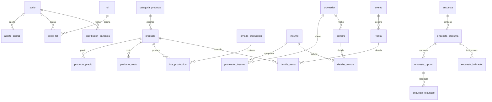

# Dip&Cheese · Base de datos del microemprendimiento

Modelo relacional en **PostgreSQL 16+** del negocio descrito en el
*Informe final Dip&Cheese* (Centro Educativo Dios Padre, 5.° B, 4/11/2026).

El objetivo es convertir el informe narrativo en una base de datos consultable:
socios y capital, productos, insumos, proveedores, producción, ventas, punto de
equilibrio, estados contables, objetivos, encuestas y distribución de ganancias.

> Este módulo es independiente de la base `foodstore` del TP de Base de Datos II
> que está en el resto del repositorio. Vive en su propio esquema (`dipcheese`).

---

## 1. Estructura

```text
dip-and-cheese-db/
├─ run_all.ps1              # Ejecuta todo (busca psql automáticamente)
├─ README.md
└─ sql/
   ├─ 00_reset.sql          # Borra el esquema (opcional, para re-ejecutar)
   ├─ 01_schema.sql         # Tablas, constraints e índices
   ├─ 02_data.sql           # Datos del informe + ajuste de secuencias
   ├─ 03_views.sql          # Vistas de negocio, control e integridad
   ├─ 04_queries.sql        # Consultas de explotación
   └─ 05_verificacion.sql   # Controles automáticos (falla si algo no cuadra)
```

## 2. Modelo de datos

### Organización y capital
| Tabla | Contenido |
|---|---|
| `socio` | Los 5 socios, con 20% de participación cada uno. |
| `aporte_capital` | Aportes iniciales ($68.187 c/u) y ampliación agregada hasta el capital social final. |
| `rol` / `socio_rol` | Áreas del organigrama. El informe solo identifica a Jeremías García en RRHH. |

### Productos, insumos y proveedores
| Tabla | Contenido |
|---|---|
| `categoria_producto` / `producto` | Chipá de queso, chipá de jamón y queso, nachos, dips, combo y chipá congelado. |
| `producto_precio` / `producto_costo` | Precios y costos con vigencia temporal (mayo-junio / agosto-octubre). |
| `insumo` | Fécula, huevos, quesos, manteca, aceite, leche, condimentos, verduras, nachos y descartables. |
| `proveedor` / `proveedor_insumo` | Suazo S.R.L., proveedor de fécula, Nachos Chamaco y los planes B (La Picada, Átomo). |
| `compra` / `detalle_compra` | Preparadas para registrar compras (el informe no publica el detalle). |

### Producción y ventas
| Tabla | Contenido |
|---|---|
| `costo_fijo` | Mano de obra: $58.506. |
| `jornada_produccion` / `lote_produccion` | Jornada tipo de 10 tandas × 36 chipás = 30 docenas. |
| `evento` | Los 4 actos escolares. |
| `venta` / `detalle_venta` | Recaudación por acto, 52 encargos congelados y ventas no discriminadas. |
| `punto_equilibrio_mensual` | Unidades vendidas, de equilibrio y resultado reportado por mes. |

### Contabilidad, objetivos y encuestas
| Tabla | Contenido |
|---|---|
| `estado_resultado_concepto` | Ventas, costo de productos, sueldos y muestras. |
| `estado_patrimonial_rubro` | Activo corriente/no corriente, pasivo y patrimonio neto. |
| `objetivo` | Metas del año y estado de cumplimiento. |
| `billetera_virtual` / `rendimiento_financiero` | Mercado Pago (1,46% mensual), Naranja (1,58%) y ~$7.000 de rendimientos. |
| `distribucion_ganancia` | $90.111 para cada socio. |
| `encuesta` + `encuesta_pregunta` / `opcion` / `resultado` / `indicador` | Encuestas de preferencia (40) y satisfacción (19), con conteos y promedios. |

### Diagrama (núcleo)



## 3. Cifras clave del informe (y cómo se controlan)

| Concepto | Importe |
|---|---:|
| Ventas totales (mayo-octubre) | $1.451.937 |
| Costo de productos vendidos | $679.702 |
| Resultado bruto | $772.235 |
| Sueldos y jornales | $292.530 |
| Muestras y degustaciones | $29.150 |
| **Resultado neto** | **$450.555** |
| Activo total | $1.904.023 |
| Pasivo | $292.530 |
| Patrimonio neto | $1.611.493 |
| Capital inicial | $340.935 |
| Capital social final | $1.160.938 |
| Ganancia por socio | $90.111 |

Indicadores derivados:

- Margen bruto: **53,19%**
- Margen neto: **31,03%**
- Retorno sobre el capital inicial: **132,15%**

### Conciliación de ventas

| Canal | Total |
|---|---:|
| 4 actos escolares | $601.000 |
| 52 encargos de chipá congelado | $683.950 |
| Ventas no discriminadas en el informe | $166.987 |
| **Total** | **$1.451.937** |

El informe solo detalla los actos y los encargos: los $166.987 restantes se
registran con el canal `no_discriminado` para que la suma cierre exactamente
contra el estado de resultados.

### Punto de equilibrio

| Mes | Vendidas | Equilibrio | Resultado calculado | Reportado |
|---|---:|---:|---:|---:|
| Mayo | 551 | 161 | 390 | 396 |
| Junio | 473 | 188 | 285 | 285 |
| Agosto | 180 | 205 | −25 | −25 |
| Septiembre | 318 | 136 | 182 | 182 |
| Octubre | 600 | 149 | 451 | 451 |
| **Total** | **2.122** | **839** | **1.283** | **1.289** |

## 4. Discrepancias y datos no documentados

La vista `vw_inconsistencias` las expone explícitamente; no se corrigieron en
silencio:

1. **Mayo:** el informe publica 396 unidades de ganancia, pero
   `551 − 161 = 390`. Diferencia de 6 unidades.
2. **Ventas:** actos + encargos suman $1.284.950, no $1.451.937. Faltan
   $166.987 sin detallar.
3. **Capital social:** el informe declara $1.160.938, pero solo documenta
   $340.935 de aportes iniciales. El origen de los $820.003 restantes no está
   explicado.

## 5. Supuestos

- Las **fechas** de aportes, jornada de producción, encuesta de satisfacción y
  cierre de encargos son estimadas (el informe no las precisa) y están marcadas
  en la columna `nota`.
- El **costo de productos vendidos** ($679.702) se deriva de
  ventas − resultado bruto, porque el informe no lo publica directamente.
- Los **costos y márgenes por producto** de las figuras 3 y 4 no están en el
  texto: `producto_costo` queda vacía y `vw_margen_producto` devuelve `NULL`
  hasta cargarlos.
- Los **precios** cargados ($4.500 y $3.000) son los de referencia de la
  encuesta, no una lista de precios final.
- El **organigrama** completo está en los anexos: solo se asigna el rol de RRHH
  documentado en el texto.
- Las **docenas vendidas por acto y por mes** no se publican, por eso los
  objetivos 2 y 3 quedan en estado `sin_medicion`.
- El **medio de pago** por venta no se discrimina en el informe; se usa
  `indistinto` a nivel de venta y se registran las billeteras por separado.
- Los **rendimientos financieros** ($7.000) se cargan como un total aproximado,
  sin reparto entre Mercado Pago y Naranja.

## 6. Cómo ejecutar

Requisitos: PostgreSQL 16+ y `psql`.

```powershell
# 1. Crear la base (una sola vez)
createdb -U postgres -h localhost -p 5432 dipcheese

# 2. Contraseña para psql
$env:PGPASSWORD = 'tu_password'

# 3. Ejecutar todo desde cero
.\run_all.ps1 -Reset
```

Sin el script, con `psql` directo:

```powershell
psql -U postgres -d dipcheese -v ON_ERROR_STOP=1 -f sql/00_reset.sql
psql -U postgres -d dipcheese -v ON_ERROR_STOP=1 -f sql/01_schema.sql
psql -U postgres -d dipcheese -v ON_ERROR_STOP=1 -f sql/02_data.sql
psql -U postgres -d dipcheese -v ON_ERROR_STOP=1 -f sql/03_views.sql
psql -U postgres -d dipcheese -v ON_ERROR_STOP=1 -f sql/05_verificacion.sql
```

`05_verificacion.sql` lanza una excepción si algún total no coincide con el
informe. Las discrepancias del documento fuente se muestran aparte y no abortan
la ejecución.

## 7. Consultas disponibles

`sql/04_queries.sql` incluye, entre otras:

- Estado de resultados y estado patrimonial.
- Punto de equilibrio mensual con detección de diferencias.
- Ventas por canal y conciliación contra el estado de resultados.
- Aportes por socio, capital social y retorno de la inversión.
- Distribución de ganancias.
- Cumplimiento de objetivos.
- Resultados de encuestas con porcentajes calculados.
- Proveedores, insumos y planes B.
- Márgenes por producto y costo por docena de chipá.
- Panel de indicadores generales.

Ejemplo rápido:

```sql
SET search_path TO dipcheese, public;
SELECT * FROM vw_estado_resultados;
SELECT * FROM vw_punto_equilibrio;
SELECT * FROM vw_verificacion_integridad;
```
